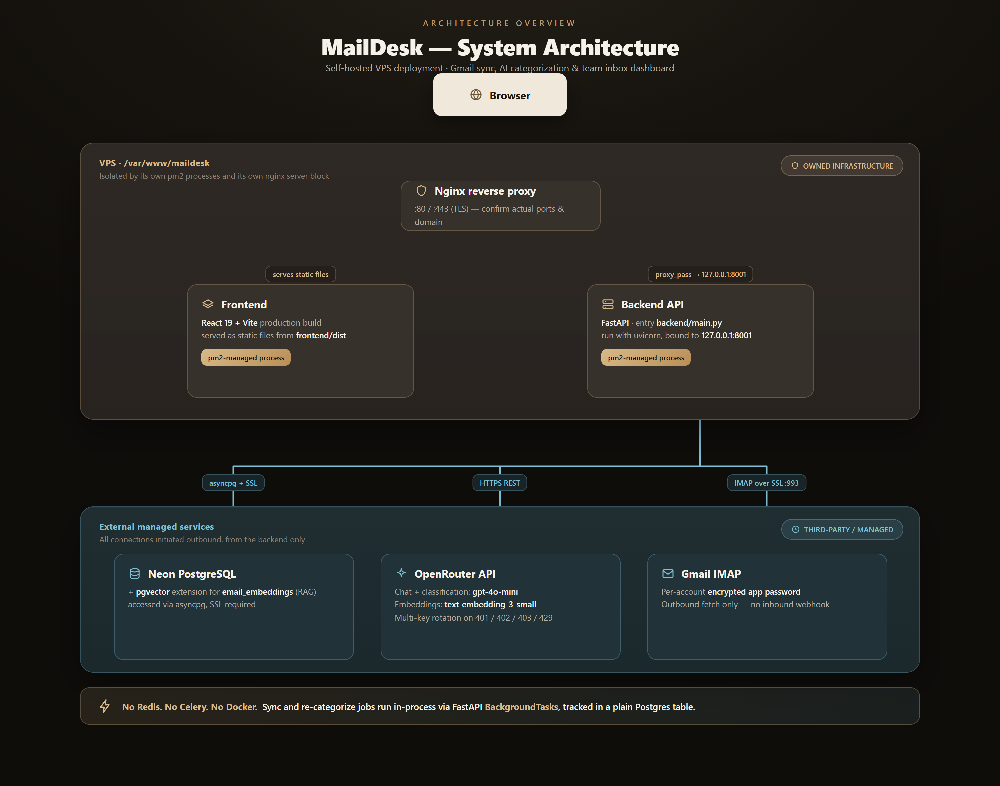
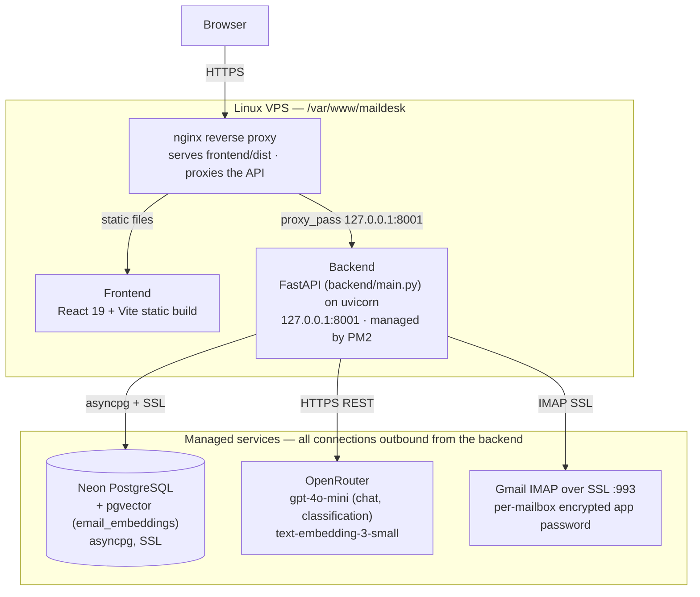

# MailDesk — Architecture

This describes the self-hosted production setup: one Linux VPS running the frontend and API behind nginx, with three managed services outside it. The Render/Vercel alternative is in [DEPLOY.md](DEPLOY.md).

## Request paths

**Sync.** `POST /emails/{account_id}/sync` creates a row in `background_jobs` and starts a FastAPI `BackgroundTasks` coroutine. The coroutine fetches new messages over IMAP, upserts them, matches Sent-folder replies, categorises new emails (keyword rules, then batched LLM calls), refreshes the inbox digest and re-embeds changed emails. The frontend polls `GET /jobs/{job_id}` for progress.

**Chat.** `POST /emails/{account_id}/chat`:
1. Per-user rate limit check (counts uncached chat calls in `ai_usage_logs`).
2. Compute an *inbox fingerprint* — a hash of the mailbox's synced state.
3. Look up `chat_answer_cache`: exact question hash, then semantic match on the question embedding (cosine distance ≤ 0.08). Both lookups are scoped to user, mailbox and fingerprint, so any inbox change invalidates old answers.
4. On a miss: build the prompt from the inbox digest + top-8 emails retrieved from `email_embeddings`, call the model, store the answer and its embedding.

## Design decisions

| Decision | Why | Trade-off |
|---|---|---|
| In-process background tasks, job state in Postgres | One process to deploy; no Redis or worker to run on a small VPS | A restart interrupts an in-flight sync |
| pgvector in the main database | Embeddings live next to the rows they describe; isolation is a `WHERE` clause | Shares database resources with the app |
| Keyword rules before the LLM | Obvious emails (OTPs, invoices, newsletters) cost nothing to classify | Rules need occasional tuning |
| Cache keyed to inbox fingerprint | Repeated questions are free, and answers never go stale | Any new email clears the cache for that mailbox |
| Multiple API keys with failover | Survives a single key hitting a quota or rate limit | More keys to manage |
| IMAP + app passwords | Works for any Gmail account without a Google Cloud verification process | Less granular than OAuth scopes; passwords must be encrypted at rest (Fernet) |

## Not present (by design)

No message queue, no separate cache service, no container images. The API process, Postgres and the two external APIs are the entire runtime.
